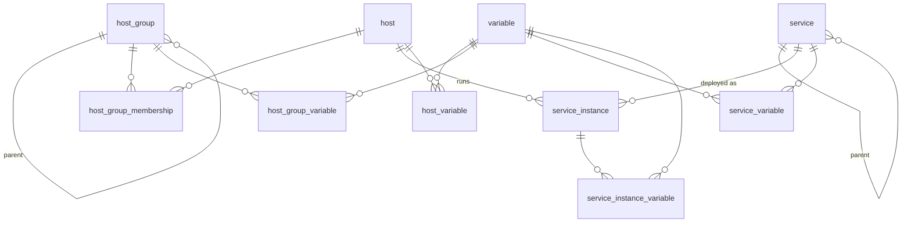

# The inventory data model

The inventory is stored in one SQLite database with a fixed set of eleven tables, shared by Lager and `cli/si` (see ADR 0002 for why it is frozen). Lager's domain model is mapped onto these tables as they are, quirks included, instead of onto a schema designed for Lager. This record describes that model so that nobody has to reverse-engineer it from the SQL, and so the quirks are recognised as known and deliberate, not fixed in passing.

## Entities

| Table | Domain concept | Columns | Keys and constraints |
|---|---|---|---|
| `host` | Host | `id`, `name` | `id` is the rowid. |
| `host_group` | Group | `id`, `parent`, `name` | `parent` is the Parent Group (NULL for a top-level Group). |
| `host_group_membership` | a Host's membership of a Group | `host`, `group` | Primary key (`host`, `group`). |
| `service` | Service | `id`, `name`, `parent` | `parent` is the Parent Service (NULL if none). |
| `service_instance` | Service Instance | `id`, `service`, `host`, `ip`, `name` | `name` is the Instance Name. `service`, `host`, `ip` and `name` are NOT NULL. Unique (`service`, `host`, `name`). |
| `variable` | Variable name | `id`, `name` | One row per Variable name, shared by all four value tables. |
| `host_variable` | Own Variable of a Host | `variable`, `host`, `value` | Primary key (`variable`, `host`). |
| `host_group_variable` | Own Variable of a Group | `variable`, `group`, `value` | Primary key (`variable`, `group`). |
| `service_variable` | Own Variable of a Service | `variable`, `service`, `value` | Primary key (`variable`, `service`). |
| `service_instance_variable` | Own Variable of a Service Instance | `variable`, `instance`, `value` | Primary key (`variable`, `instance`). |
| `db_version` | schema version | `key`, `version` | A single row: `key` is constrained to `'single-row'`. `version` is currently `1`. |

All `id` columns are `INTEGER PRIMARY KEY`, so they are SQLite rowids that SQLite assigns on insert. All `value` columns are NOT NULL text holding a JSON document. The Server Index is not a column: it is the `server_index` Variable of a Host.

## How the model is meant to be read

- **Names are the identity users see.** Every lookup in `cli/si` is by `name`, and the `id`s are internal. A Service Instance is identified by (Host, Service, Instance Name).
- **Variables are split in two.** The name lives once in `variable`. The value lives in whichever of the four `*_variable` tables matches the entity it's set on. A Variable name can exist with no values.
- **Hierarchy is a nullable self-reference.** Both Groups and Services form trees through `parent`. Effective Variables are worked out by walking those trees with recursive queries, never stored.
- **Group membership is direct only.** `host_group_membership` records the Groups a Host was put in. Membership of Parent Groups is implied, not stored.

## Known quirks (kept on purpose)

- **Broken foreign keys.** `host_group.parent` references `host_groups(id)` and `host_group_variable."group"` references `"group"(id)`. Neither table exists. This is why foreign-key enforcement is off (ADR 0002).
- **No `ON DELETE` actions.** Nothing cascades in the database. Deleting a row leaves its dependants behind unless the writer removes them.
- **Names are not constrained.** `name` is nullable and not unique in `host`, `host_group`, `service` and `variable`, and none of them is indexed. Writers enforce uniqueness themselves (issue #1 proposes moving the rule into the schema).
- **Loose column types.** `service.parent` has no declared type. `host_group_membership`'s columns are not NOT NULL, even though they form its primary key.
- **Reserved word as a column name.** `host_group_variable` and `host_group_membership` have a column called `group`, which must always be quoted.
- **Hierarchies can contain cycles.** Nothing in the schema prevents a Group or Service from being its own ancestor. Writers must reject this, because the recursive queries would never end (issue #2).
- **IPs are plain text.** `service_instance.ip` is stored as written. Nothing in the schema checks that it is an address.
